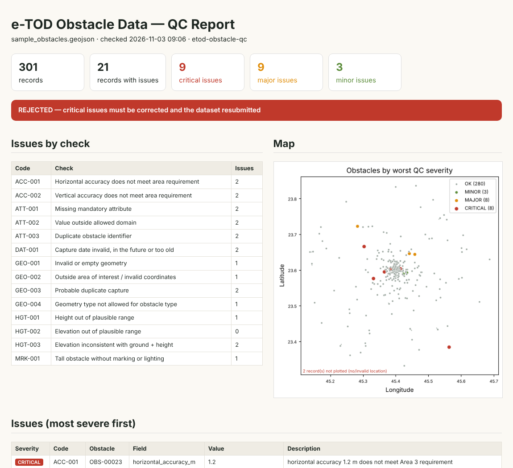
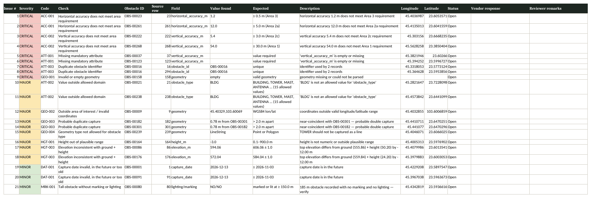

# e-TOD Obstacle Data QC

[](https://github.com/kashifrazi338/etod-obstacle-qc/actions/workflows/tests.yml)


**Rule-based quality control for electronic Terrain and Obstacle Data (e-TOD) obstacle datasets.** It produces an issue log ready to send to the vendor, an HTML summary with an acceptance verdict, and a GeoJSON layer of flagged obstacles.

When a supplier delivers obstacle data for an aerodrome, every record must be checked before acceptance: mandatory attributes, allowed values, positional and vertical accuracy against the requirement for its coverage area, height consistency, duplicates and geometry. Done by hand in a GIS, this is slow and inconsistent between reviewers. This tool turns the supervisor's checklist into **repeatable, configurable rules** and writes the results in the format a vendor can act on.



---

## Checks

| Code | Check | Default severity |
|---|---|---|
| ATT-001 | Missing mandatory attribute | CRITICAL |
| ATT-002 | Value outside the allowed domain (type, lighting, marking, area) | MAJOR |
| ATT-003 | Duplicate obstacle identifier | CRITICAL |
| GEO-001 | Invalid or empty geometry | CRITICAL |
| GEO-002 | Coordinates invalid or outside the area of interest | MAJOR |
| GEO-003 | Probable double capture (near-coincident obstacles of similar height) | MAJOR |
| GEO-004 | Geometry type not allowed for the obstacle type (e.g. a tower captured as a line) | MAJOR |
| HGT-001 | Height out of plausible range | MAJOR |
| HGT-002 | Elevation out of plausible range | MAJOR |
| HGT-003 | Top elevation ≠ ground elevation + height | MAJOR |
| ACC-001 | Horizontal accuracy does not meet the coverage-area requirement | CRITICAL |
| ACC-002 | Vertical accuracy does not meet the coverage-area requirement | CRITICAL |
| MRK-001 | Tall obstacle recorded without marking or lighting | MINOR |
| DAT-001 | Capture date invalid, in the future or older than the currency requirement | MINOR |

The default accuracy requirements per coverage area (Areas 1, 2a–2d, 3 and 4) follow the ICAO Annex 15 / PANS-AIM obstacle data tables. **Every threshold, allowed value and severity lives in [`rules/default_rules.yaml`](rules/default_rules.yaml).** Copy that file, adjust it to your contract specification, and pass it with `--rules`.

## Outputs

| File | Purpose |
|---|---|
| `qc_issue_log.xlsx` | **Vendor issue log.** *Summary* sheet (verdict and counts per check), *Issue Log* sheet (one row per issue with obstacle ID, field, value found, expected value, coordinates, a *Status* dropdown and *Vendor response* / *Reviewer remarks* columns), and *Obstacles* sheet (worst severity per record). Filtered, colour-coded and print-ready. |
| `qc_report.html` | One-page summary with KPIs, verdict, issues by check, a map and the issue list |
| `flagged_obstacles.geojson` | Flagged records with `qc_worst`, `qc_issues` and `qc_codes` attributes. Load it in ArcGIS Pro or QGIS to review issues on the map. |



**Verdict logic:** any CRITICAL issue → *Rejected*. MAJOR issues only → *Conditionally accepted*. MINOR only → *Accepted with minor comments*.

## Quick start

```bash
git clone https://github.com/kashifrazi338/etod-obstacle-qc.git
cd etod-obstacle-qc
pip install -r requirements.txt

# Generate a 300-obstacle synthetic dataset with 19 known errors and check it
python -m etod_qc demo --out demo_output
```

### On your own data

```bash
python -m etod_qc check delivery_2026_11.geojson --out qc_output
python -m etod_qc check obstacles.csv --rules my_project_rules.yaml --out qc_output

# Use in an automated acceptance pipeline: exit code 1 if any CRITICAL issue exists
python -m etod_qc check delivery.geojson --fail-on CRITICAL
```

**Input formats:** GeoJSON (WGS84), or CSV with either `lon`/`lat` columns or a `wkt` column (for lines and polygons). Templates are in [`examples/`](examples/). The expected attributes are `obstacle_id`, `obstacle_type`, `elevation_m`, `height_m`, `horizontal_accuracy_m`, `vertical_accuracy_m`, `area`, `lighting`, `marking` and `capture_date`, plus an optional `ground_elev_m` for the elevation consistency check. Field names and allowed values can be changed in the rules file.

## Verified behaviour

The test suite (`pytest -q`, run on every push by GitHub Actions) generates a dataset with known, injected errors and asserts that:

- **every injected error is detected** (recall), and
- **no clean record is flagged** (no false positives).

It also tests the accuracy thresholds at their exact limits for each coverage area, CSV and WKT input, the Excel structure, and the `--fail-on` exit code.

## Project structure

```
etod_qc/
├── io.py           GeoJSON / CSV loading, rules loading
├── checks.py       the 14 checks + severity assignment
├── report.py       Excel issue log, HTML report, flagged GeoJSON
├── sample_data.py  synthetic aerodrome dataset with injected errors
└── __main__.py     command-line interface
rules/default_rules.yaml   all thresholds, domains and severities
examples/                  sample dataset and CSV templates
tests/                     pytest suite
```

## Notes and scope

- All data in this repository is **synthetic**. It is generated around a fictitious aerodrome in open desert. No real, client or operational aeronautical data is included.
- The tool supports the reviewer and does not replace them. Findings such as MRK-001 are flags for verification, not determinations under Annex 14.
- Always confirm the numerical requirements against the regulatory edition and the project specification that apply to your work.

## Author

**Kashif**: Senior GIS Consultant & Project Manager, Riyadh · PMP · PSM · PSPO
🌐 [kashifrazi338.github.io](https://kashifrazi338.github.io) · ✉ cartosat.kashif@gmail.com

MIT License
